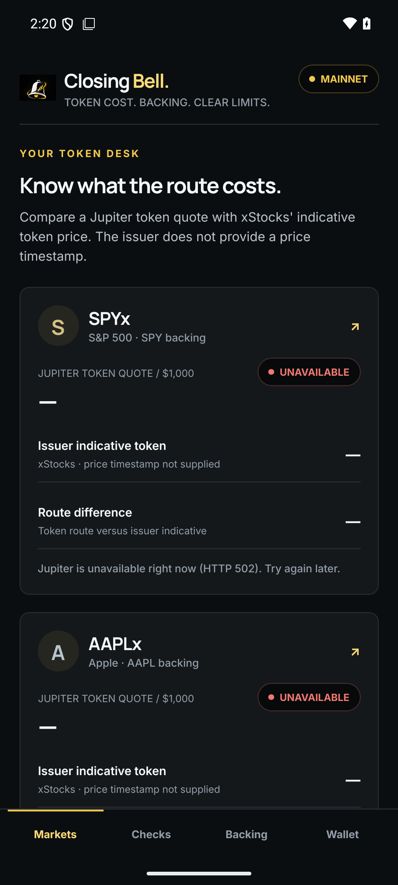
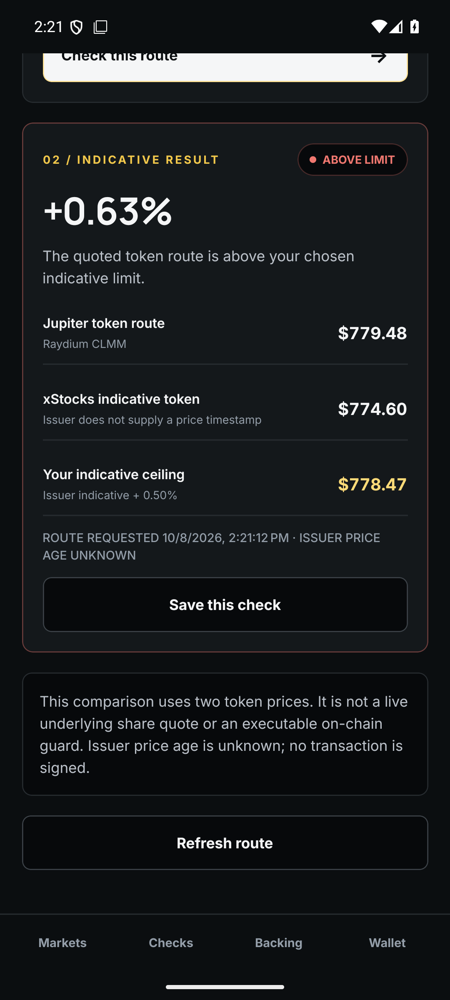
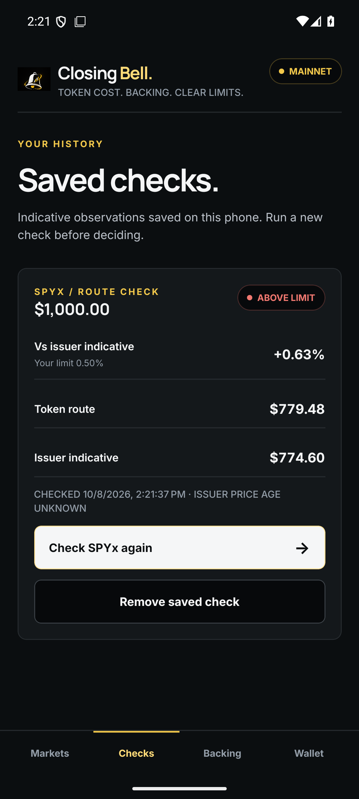
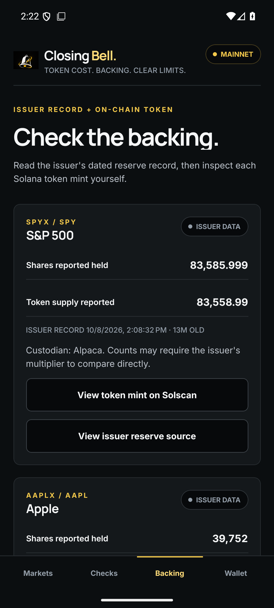

# Closing Bell Mobile — submission

**A read-only Android app that shows what a Jupiter route for a tokenized stock costs against the issuer's own indicative token price, next to the issuer's dated reserve record and the token's on-chain mint.**

Closing Bell's main project measures a persistent premium that xStocks trade at over the shares they wrap, and enforces a price band on-chain. This app is the phone-sized companion: before you route a swap, check the route against a limit you choose, save that observation, and look at what backs the token. It runs standalone. Market checks call Jupiter, xStocks and Solana RPC directly and do not depend on the Closing Bell web backend or a Pyth key.

## Try it

1. Install the release APK (Android 7.0+). It is signed with the same certificate that `closing-bell-eight.vercel.app/.well-known/assetlinks.json` publishes, so Mobile Wallet Adapter wallets can verify the app's identity.
2. **Markets:** each card shows the Jupiter route price for $1,000 of SPYx, AAPLx, NVDAx or TSLAx, xStocks' indicative token price, and the difference.
3. Open **SPYx**, enter an amount, pick a limit (0.10–1.00%) and tap **Check this route**. The result says whether the route is inside or above your limit and shows your price ceiling.
4. **Save this check**, then open **Checks**. Saved checks survive an app restart; **Check SPYx again** restores the amount and limit for a like-for-like recheck.
5. **Backing:** the issuer's timestamped proof-of-reserves record per token, with links to the issuer source and the mint on Solscan.
6. **Wallet:** connect an MWA wallet or paste any address to read xStock token balances. The app never signs or spends.

Example from the October 8, 2026 test: a $1,000 SPYx route priced at $779.48 per token against an issuer indicative $774.60, **+0.63%**, above a 0.50% limit.

## Screenshots

| Markets | Route check | Saved checks | Backing |
| --- | --- | --- | --- |
|  |  |  |  |

## What has been verified

- TypeScript validation and signed release builds (v0.1.0 on October 7, v0.1.2 on October 8, 2026).
- **On a physical Android 13 phone with Solflare:** market check, save, restart and update persistence, recheck, backing, and wallet connect, read-only holdings lookup and disconnect. No signature was requested.
- On Android 16 emulators: the market comparison, save and restart, recheck restoration, backing records, and address lookup. Wallet connect and disconnect were tested with Solana Mobile's test wallet, which reported `Verification successful` for the app identity.
- At 320 × 640 dp with a 1.3 system font scale, prices, limits and navigation stay legible.
- With the network off, every screen shows a plain error naming the failed source (Jupiter, xStocks or Solana RPC) and a retry that recovers once the network returns. A real, transient Jupiter HTTP 503 during testing produced the same handled message.

Details: [emulator QA record](emulator-qa.md).

## Limits, stated plainly

- **This compares two token prices, not the underlying share.** The reference is xStocks' indicative token price, not a live SPY/AAPL/NVDA/TSLA quote.
- **The issuer price has no timestamp.** The app labels it `AGE UNKNOWN` rather than implying freshness.
- **No trade and no on-chain guard here.** The app is informational. The on-chain enforcement lives in the main Closing Bell program, which this app does not call.
- **The reserve record is the issuer's own report.** The Solscan link verifies the mint on-chain; it does not audit custody.

## Links

- Main project (premium measurement and on-chain guard): https://github.com/GuTS805/Closing-Bell
- Live web demo: https://closing-bell-eight.vercel.app
- Mobile source: https://github.com/GuTS805/closing-bell-mobile
- Release APK: https://github.com/GuTS805/closing-bell-mobile/releases
